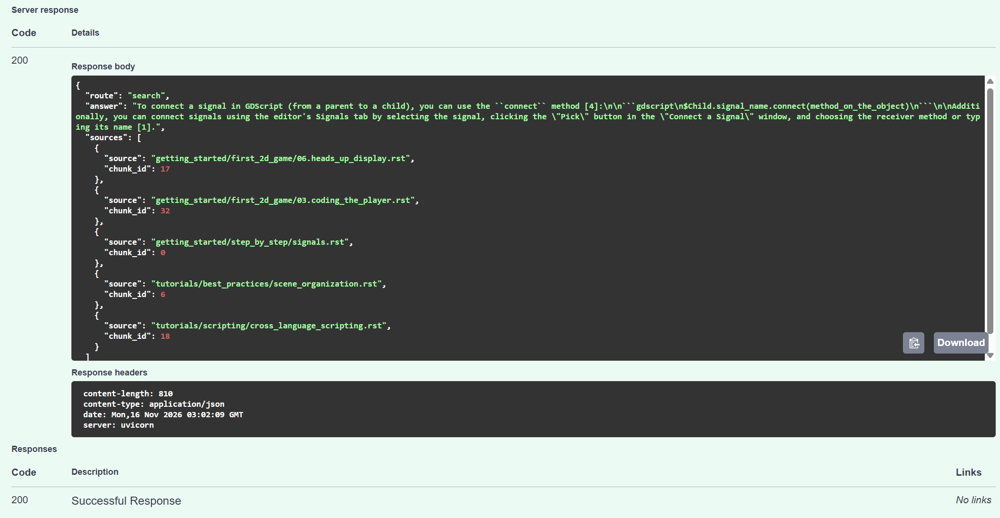
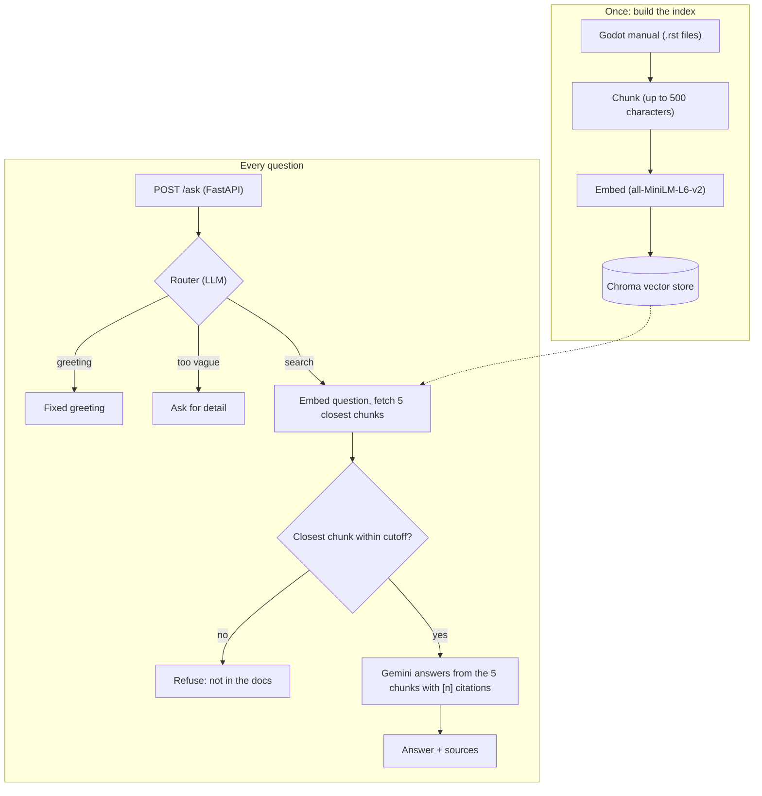

# Godot Docs Assistant

A small retrieval-augmented generation (RAG) app that answers questions about the Godot Engine manual and cites the pages it used. It retrieves the most relevant passages with a vector search, then has an LLM answer from only those passages. A small LangGraph workflow decides how to handle each question, and the whole thing is served through a FastAPI endpoint that can run in Docker.

I built it to learn how RAG systems work end to end, including how to measure them honestly. See [EVALUATION.md](EVALUATION.md) for results, failure cases and caveats. I built it with guidance from an AI assistant (Claude), and I ran, tested and evaluated each part myself.

**Unofficial:** this project is not affiliated with or endorsed by the Godot Engine project.

## Demo

A question sent to the API running in the Docker container:



## How it works



1. **Index (run once).** The `getting_started` and `tutorials` folders of the manual (434 `.rst` files) are split into 12,251 chunks of up to 500 characters. Each chunk is turned into a 384-number embedding with `all-MiniLM-L6-v2` and stored in Chroma.
2. **Route.** For each question, an LLM labels it as a greeting, too vague, or a real search. Greetings and vague questions get a fixed reply without any search.
3. **Retrieve.** The question is embedded and the 5 closest chunks are fetched from Chroma.
4. **Check.** If even the closest chunk is farther than a cutoff (1.05), the app refuses without calling the model.
5. **Answer.** Gemini (`gemini-3.5-flash-lite`) answers using only the 5 numbered excerpts and cites them as `[n]`. If they do not contain the answer, it says so.
6. **Respond.** The API returns the route, the answer and the sources (page and chunk).

The router is a routed workflow with fixed steps, built with LangGraph. It is not an autonomous agent.

## Results

Evaluated on 18 questions with expected pages and keywords (16 answerable, 2 out of scope), single run:

| | Result |
|---|---|
| Answerable questions passed | 12 / 16 |
| Out-of-scope questions refused | 2 / 2 |
| Retrieval hit@5, page level | 14 / 16 |
| Retrieval hit@5, chunk level (stricter) | 13 / 16 |

These numbers come from a small test set that is probably easier than real use, and the model output varies between runs. [EVALUATION.md](EVALUATION.md) explains how each number is measured, lists every failure case and states the limits.

## Known limitations

- Retrieval sometimes misses the chunk that holds the answer, for example when a question is vague or the answer ranks below the top 5.
- The distance cutoff separates unrelated questions well but cannot separate questions about other game engines from hard Godot questions. The prompt rule is the second line of defence, and it was checked on a single run.
- Code tabs can mix GDScript and C#, and the small embedding model barely separates 2D from 3D.
- Free-tier API limits apply.

## Setup

Commands are for Windows PowerShell, which is what this was built and tested on.

**You need:** Python 3.12, Git, and a free Gemini API key from [Google AI Studio](https://aistudio.google.com/). Docker Desktop is only needed for the Docker steps.

1. **Clone this repo and move into it.**

```
git clone https://github.com/hrihaanG/godot-docs-assistant.git
cd godot-docs-rag
```

2. **Create and activate a virtual environment, then install the requirements.**

```
py -m venv .venv
.venv\Scripts\activate
pip install -r requirements.txt
```

3. **Add your API key.** Create a file named `.env` in the project folder containing one line, with no quotes:

```
GEMINI_API_KEY=your-key-here
```

4. **Download the Godot docs** (they are not included in this repo, see Attribution):

```
git clone --depth 1 https://github.com/godotengine/godot-docs.git data/godot-docs
```

5. **Build the index** (takes a few minutes the first time):

```
python build_index.py
```

6. **Try it from the command line:**

```
python agent.py "What is the difference between _process and _physics_process?"
```

## Run the API

```
uvicorn api:app
```

Open `http://127.0.0.1:8000/docs`, open `POST /ask`, click **Try it out** and send:

```json
{"question": "Does a navigation mesh take an agent's radius into account when pathfinding?"}
```

The response contains `route`, `answer` and `sources`. `GET /health` returns `{"status": "ok"}`. Questions must be 1 to 500 characters.

## Run in Docker

The image bundles the code, the embedding model and the index, so download the docs and build the index (steps 4 and 5 above) first. The API key is passed in when the container starts and is never stored in the image.

```
docker build -t godot-docs-assistant .
docker run --rm -p 127.0.0.1:8000:8000 --env-file .env godot-docs-assistant
```

Then open `http://127.0.0.1:8000/docs`. The image is about 2.9 GB on disk, mostly PyTorch and its dependencies.

## Reproduce the evaluation

```
python validate_eval.py
python eval_retrieval.py
python eval_answers.py
python eval_answers.py --agent
```

The last two call the Gemini API and take a few minutes. `eval_answers.py` runs the plain pipeline, and with `--agent` it runs the routing graph. Both overwrite the saved results files.

## Project layout

Core files:

| File | Purpose |
|---|---|
| `load_docs.py` | Reads the `.rst` files |
| `chunk_docs.py` | Splits documents into chunks |
| `build_index.py` | Embeds the chunks and stores them in Chroma |
| `search.py` | Retrieves the closest chunks for a question |
| `answer.py` | Builds the prompt and calls Gemini |
| `agent.py` | The LangGraph routing workflow |
| `api.py` | The FastAPI endpoint |
| `Dockerfile` | Container build |

Evaluation: `eval_questions.json`, `validate_eval.py`, `eval_retrieval.py`, `eval_answers.py` and the saved `eval_*_results*.json` files.

Exploration and diagnostic scripts used during development: `check_*.py`, `diagnose_misses.py`, `distance_check.py`, `embed_test.py`, `graph_toy.py`, `hello_llm.py`, `inspect_chunks.py`, `sample_pages.py`, `threshold_test.py`, `try_search.py`.

## Tech

Python, sentence-transformers, Chroma, Google Gemini (`google-genai`), LangGraph, FastAPI, uvicorn, Docker.

## Attribution

This project uses the *Godot Engine documentation* by Juan Linietsky, Ariel Manzur and the Godot community, available at [godotengine/godot-docs](https://github.com/godotengine/godot-docs) and licensed under [CC BY 3.0](https://creativecommons.org/licenses/by/3.0/). The documentation itself is not included in this repository.

**Changes made:** the original text has been modified. It is split into chunks, and excerpts are quoted in answers and in the evaluation files. Only the `getting_started` and `tutorials` folders are used.

This project is not affiliated with or endorsed by the Godot Engine project or the original authors.

## Licence

The code in this repository is released under the [MIT License](LICENSE).
